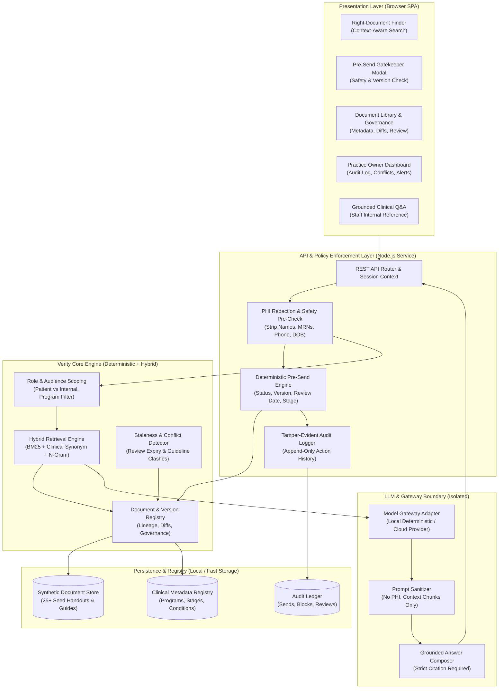
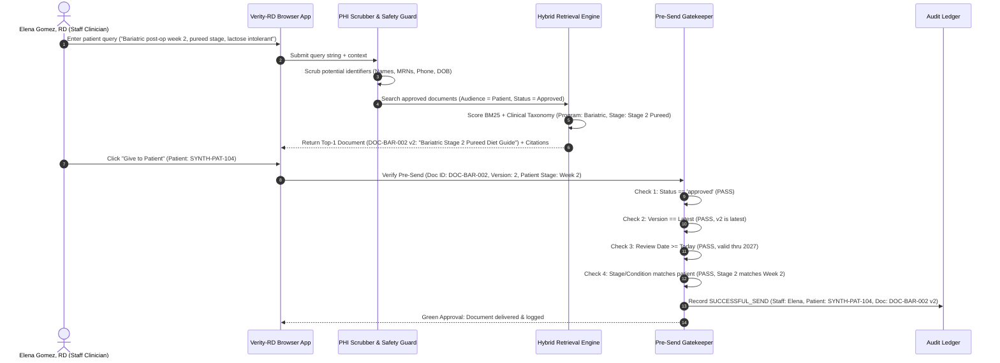
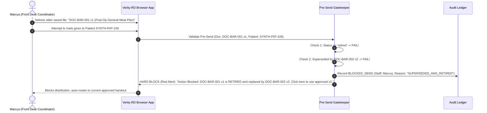

# Verity-RD Architecture & Data Flow Specification
**System:** Clinical Knowledge Search & Distribution Governance Platform  
**Lineage:** Verity-pattern prototype (`ngupta1137/verity` adaptation)  
**Classification:** Prototype Architecture Specification  

---

### 1. High-Level System Architecture

---

### 2. Runtime Data Flow Maps

#### Flow A: Right-Document Finder & Pre-Send Check

#### Flow B: Trap Interception (Superseded or Retired Document Attempt)

---

### 3. LLM Call Boundaries & Data Isolation

To prevent hallucination, data leakage, and compliance breaches, the LLM is strictly isolated within defined boundaries:

| Task / Flow | LLM Involvement? | What Data the LLM Sees | Fallback / Deterministic Rule |
| :--- | :--- | :--- | :--- |
| **Pre-Send Verification Gate** | **NO (100% Deterministic)** | **None.** No data sent to LLM. | Rule engine checks boolean logic (`status == 'approved'`, `version == latest`, `review_date >= today`, `stage == patient_stage`). |
| **Document Discovery / Ranking** | **NO (Hybrid Deterministic)** | **None.** No patient identifiers. | BM25 + clinical taxonomic mapping + n-gram keyword overlap. |
| **Grounded Staff Q&A** | **YES (Optional Composer)** | Redacted staff query + Exact text chunks of approved documents only. **Zero PHI.** | Model must cite exact Document ID and Section. If confidence < 0.85 or evidence insufficient, deterministic refusal triggers: *"No approved document contains this guidance."* |
| **Metadata Tag Extraction** | **YES (Assisted Ingestion)** | Unstructured document text (PDF/DOCX). | Dietitian/Owner must review and confirm extracted metadata before publishing. |
| **Conflict Detection** | **HYBRID (Deterministic + LLM)** | Pairs of document text sections within the same clinical program. | Cosine similarity flags overlapping scopes; rule checks numerical divergences (e.g., protein g/day, carb limits). |

---

### 4. Component Status Matrix (Built vs. Designed vs. Proposed)

| Component | Status | Implementation Details |
| :--- | :--- | :--- |
| **Document Library & Metadata Registry** | **BUILT** | Full registry with Program, Condition, Stage, Audience, Owner, Version, Status, and Review-by date. |
| **Version Lineage & Visual Diff Engine** | **BUILT** | Track superseded versions, retain searchable retired docs with clear warnings, word/line level diffing. |
| **Deterministic Pre-Send Gatekeeper** | **BUILT** | Hard blocks on Draft, Retired, Superseded, Expired, and Stage-mismatched deliveries. |
| **Context-Aware Finder with Citations** | **BUILT** | Plain-language search mapping patient context to approved docs with section citations and match rationale. |
| **Staleness & Clinical Conflict Engine** | **BUILT** | Automated monitor for overdue review dates and pairwise semantic/numerical conflict detection. |
| **Tamper-Evident Audit Ledger** | **BUILT** | Structured event logging of all searches, checks, sends, and blocked attempts. |
| **Practice Owner Analytics Dashboard** | **BUILT** | Metrics for review queue, blocked sends, top documents, and staff compliance rate. |
| **Grounded Clinical Q&A with Refusal** | **BUILT** | Strict citation-backed retrieval; explicit refusal on out-of-scope/unapproved queries. |
| **Deterministic PHI Scrubber** | **BUILT** | Multi-pattern regex redacting names, MRNs, phone numbers, and dates of birth. |
| **Cloud Model Gateway (OpenAI/Anthropic/Gemini)** | **DESIGNED** | Standardized pluggable gateway interface with local deterministic mock fallback. |
| **EHR FHIR/HL7 Bi-directional Sync** | **PROPOSED** | Future integration with Epic, AthenaHealth, or SimplePractice patient records. |
| **Automated Patient SMS/Email Dispatch** | **PROPOSED** | SendGrid / Twilio integration to deliver approved PDF links to patients. |
| **Hardware-Encrypted Audit Storage (WORM)** | **PROPOSED** | Write-Once-Read-Many cloud storage (AWS S3 Object Lock) for legal audit compliance. |

---

### 5. HIPAA-Aware Production Roadmap

While this prototype is designed with HIPAA awareness, a commercial production deployment requires the following operational and architectural controls:

1. **Business Associate Agreements (BAAs):**
   - Execute BAAs with hosting provider (AWS, GCP, or Azure Healthcare), database providers, and any cloud LLM API providers (e.g., OpenAI Zero Data Retention BAA or AWS Bedrock HIPAA-eligible endpoints).
2. **Encryption Standards:**
   - **At Rest:** AES-256 encryption on all document storage volumes and database instances.
   - **In Transit:** TLS 1.3 enforced on all REST endpoints and internal microservice communication.
3. **Identity & Access Management (IAM):**
   - Integration with practice Identity Provider (Google Workspace / Microsoft Entra ID) with enforced Multi-Factor Authentication (MFA).
   - Strict Role-Based Access Control (RBAC): Dietitian, Front Desk, Clinical Director / Owner.
4. **Audit Trail Immutability & Retention:**
   - Write audit logs to an append-only, tamper-evident log stream with 6-year retention (HIPAA standard §164.312(b)).
5. **Periodic Access Reviews:**
   - Quarterly automated access reviews and credential revocation workflows for departing staff members.
